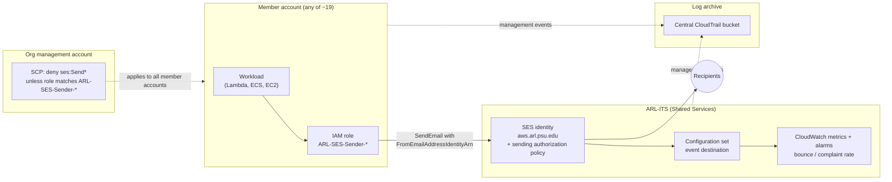

# Centralized Amazon SES Email Sending (GovCloud)

| | |
|---|---|
| **Owner** | John Tyndall |
| **Status** | Draft. Discovery in progress, no controls applied yet |
| **Last updated** | 2026-11-23 |
| **Region** | `us-gov-west-1` (AWS GovCloud US-West) |
| **Sending domain** | `aws.arl.psu.edu` |
| **Related ticket** | DNS request for SES DKIM, MAIL FROM, and DMARC records (submitted about 4 months ago, pending Cybersecurity approval) |

---

## 1. Goal

Give ARL AWS workloads one approved, auditable way to send automated email (alerts, notifications) from `@aws.arl.psu.edu`, instead of every research team setting up SES separately in each of the ~19 member accounts.

Requirements:

- One SES domain identity (`aws.arl.psu.edu`), owned by the Shared Services account (`ARL-ITS`).
- Only approved IAM roles can send. Everyone else is denied, even if they have admin in their own account.
- Outbound only. No inbound mail is received.
- Sending and configuration activity is logged and monitored.
- Operable by the SysAdmin team without software development experience.

Non-goals:

- Replacing Exchange for human email.
- Sending from `arl.psu.edu` itself.
- Marketing or bulk mail.

---

## 2. Architecture

### 2.1 Account layout

The org (`o-uwpj5760j5`) has 20 accounts, all directly under Root. There are no OUs. SCPs are enabled.

| Role in this design | Account | Profile used for discovery |
|---|---|---|
| Org management (SCPs are applied here) | ARLPSU (management) | `arlpsu-govcloud` |
| Shared Services (owns the SES identity) | `ARL-ITS` (890884507059) | `arl-its-govcloud` |
| Log archive (central CloudTrail bucket) | `ARLPSU-LogArchive` | not accessed yet |
| Test account for SCP rollout | `ARL-ITS-Sandbox` | `arl-its-sandbox-govcloud` |
| Senders | Researcher and project accounts | `<account-name>-govcloud`. Surveyed 2026-11-23, no SES in any account (Section 4.1) |

### 2.2 Sending flow



### 2.3 Controls

| # | Control | Where | Purpose |
|---|---|---|---|
| 1 | Identity sending authorization policy | `aws.arl.psu.edu` identity in `ARL-ITS` | Resource side: only org principals matching `ARL-SES-Sender-*` can use the identity |
| 2 | SCP deny on `ses:Send*` | Management account, applied to member accounts | Guardrail side: nobody outside the approved role pattern can send, regardless of local permissions |
| 3 | Role naming convention `ARL-SES-Sender-<purpose>` | Each sending account | Existing `ProtectRoles` SCP already blocks edits to `ARL-*` roles except by ITS admin roles, so researchers cannot widen a sender role |
| 4 | Configuration set with event destination | `ARL-ITS` | Records send, delivery, bounce, complaint, and reject events |
| 5 | CloudWatch alarms | `ARL-ITS` | Alerts on bounce and complaint rates |
| 6 | CloudTrail (baseline trail) | Already in place | Logs SES management and API activity |

### 2.4 Known design risk: cross-account sending

Sending through another account's identity requires the sender to pass the identity ARN as the source ARN (`FromEmailAddressIdentityArn` in SESv2, `SourceArn` in SESv1). Application code and the SDK can do that. Some AWS services and third-party tools cannot.

Fallback if a team cannot: they publish to SNS or EventBridge in their account, and one Lambda in `ARL-ITS` sends through SES. That also gives a single point for logging and throttling. We decide this per team once we know what they actually send.

---

## 3. Discovery steps and commands

Run these in PowerShell or Git Bash. All of them are read-only. Replace the profile as needed.

Log in. All 20 GovCloud profiles share one SSO session, so one login covers every account:

```
aws sso login --sso-session arlpsu-govcloud
```

Profile names are `<account-name>-govcloud` (for example `gids-basecamp-govcloud`). The older ones keep their names: `arl-its-govcloud` (Shared Services), `arl-its-sandbox-govcloud`, `gids-nimbus-govcloud`, and `arlpsu-govcloud` (management account).

TLS inspection: ARL's firewall re-signs HTTPS traffic to AWS with `ARL WAN1 Forward Trust CA`, which chains to `ARL Root CA`. Windows trusts that CA, but AWS CLI v2 uses its own CA list, so calls can fail with `CERTIFICATE_VERIFY_FAILED: self-signed certificate in certificate chain`. Fix it with `tools/aws-cli-tls-fix/Fix-AwsCliTls.bat` in this repo. Do not use `--no-verify-ssl`.

Confirm who you are (also the quickest test that a profile works):

```
aws sts get-caller-identity --profile arl-its-govcloud --region us-gov-west-1
```

Org and accounts (management profile):

```
aws organizations describe-organization --profile arlpsu-govcloud --region us-gov-west-1
aws organizations list-accounts --profile arlpsu-govcloud --region us-gov-west-1 --query "Accounts[].{Name:Name,Id:Id,Status:Status}" --output table
aws organizations list-policies --filter SERVICE_CONTROL_POLICY --profile arlpsu-govcloud --region us-gov-west-1
```

SES in Shared Services:

```
aws sesv2 list-email-identities --profile arl-its-govcloud --region us-gov-west-1
aws sesv2 get-email-identity --email-identity aws.arl.psu.edu --profile arl-its-govcloud --region us-gov-west-1
aws sesv2 get-account --profile arl-its-govcloud --region us-gov-west-1
aws sesv2 list-configuration-sets --profile arl-its-govcloud --region us-gov-west-1
aws sesv2 get-configuration-set-event-destinations --configuration-set-name my-first-configuration-set --profile arl-its-govcloud --region us-gov-west-1
```

Inbound check (expected to fail in GovCloud):

```
aws ses describe-active-receipt-rule-set --profile arl-its-govcloud --region us-gov-west-1
```

CloudTrail:

```
aws cloudtrail describe-trails --profile arl-its-govcloud --region us-gov-west-1
aws cloudtrail get-trail-status --name arl-compliance-BaselineCloudTrail --profile arl-its-govcloud --region us-gov-west-1
aws cloudtrail get-event-selectors --trail-name arl-compliance-BaselineCloudTrail --profile arl-its-govcloud --region us-gov-west-1
```

Survey of other accounts for existing SES usage (per account, run for both `us-gov-west-1` and `us-gov-east-1`):

```
aws sesv2 list-email-identities --profile <account-profile> --region us-gov-west-1
aws sesv2 get-account --profile <account-profile> --region us-gov-west-1
```

Read an SCP:

```
aws organizations describe-policy --policy-id <policy-id> --profile arlpsu-govcloud --region us-gov-west-1
aws organizations list-targets-for-policy --policy-id <policy-id> --profile arlpsu-govcloud --region us-gov-west-1
```

### Limits of the survey

- CloudTrail does not record individual `SendEmail` calls (to be confirmed against current SES documentation before we tell Cybersecurity this). A quiet survey shows who has set up SES, not everyone who has ever sent.
- Indirect senders (Cognito email, SMTP with IAM user credentials) will not show up as roles. The SCP would block them, which is why the survey comes before the rollout.

---

## 4. Findings so far

Captured 2026-11-22 around 22:51 UTC (`arl-its-govcloud`) and 2026-11-23 around 13:33 UTC (`arlpsu-govcloud`).

| Item | Finding |
|---|---|
| Profile for Shared Services | `arl-its-govcloud` maps to `ARL-ITS`, role `AdministratorAccess` |
| `ARL-ITS` account type | Member account (not the management account) |
| Management profile | `arlpsu-govcloud`, confirmed to be the management account |
| Accounts in org | 20, all active, no OUs |
| SCPs | `FullAWSAccess`, `ARL-Guardrails-Global` (attached at Root), `ARL-Guardrails-DenyIGW` |
| `ARL-Guardrails-Global` | Protects logging, monitoring, roles, account settings, and RAM sharing. **Contains no SES statements** |
| Domain identity `aws.arl.psu.edu` | Exists. Verification `FAILED`, DKIM `FAILED`, MAIL FROM `FAILED`. Expected, since the DNS records do not exist yet |
| DKIM tokens on the identity | Match the three CNAMEs in the DNS ticket, so the ticket can be fulfilled as submitted |
| Identity sending policy | None at first (`Policies: {}`). **Applied 2026-11-23 15:23 UTC**, see Section 10 |
| SES account | Sandbox (production access not enabled). Quota 200 per 24 hours, 1 per second |
| Other identities | `aws@arl.psu.edu` and `jbt8@arl.psu.edu` (verified, likely test leftovers) |
| Configuration set | `my-first-configuration-set`, reputation metrics on, no event destinations found |
| Inbound receiving | `DescribeActiveReceiptRuleSet` returned `InvalidAction` in `us-gov-west-1` |
| CloudTrail | `arl-compliance-BaselineCloudTrail`: multi-region, logging, log file validation on, management events (read and write) on, delivering to central log archive bucket, no delivery errors |

### 4.1 Org-wide SES survey

Run 2026-11-23 (13:51 UTC for `us-gov-west-1`, 14:11 UTC for `us-gov-east-1`) using one SSO profile per account (`<account-name>-govcloud`, all sharing the `arlpsu-govcloud` SSO session). Commands: `sesv2 list-email-identities` and `sesv2 get-account`, read-only.

| Result | `us-gov-west-1` | `us-gov-east-1` |
|---|---|---|
| Accounts reachable | 19 of 19 (excluding `ARL-ITS`, surveyed separately) | 20 of 20 |
| Accounts with any SES identity | 0 | 0 |
| Accounts with production access | 0 | 0 |
| Messages sent in last 24 hours | 0 | 0 |

`ARL-ITS` is the only account with SES configured in `us-gov-west-1` (Section 4 above). It has none in `us-gov-east-1`.

Conclusion: nobody in the org can send through SES today, so the SCP in Section 6.2 will not break an existing sender. This does not prove nobody has ever sent, only that nothing is configured and nothing sent in the last 24 hours.

### 4.2 How the org is built (discovered 2026-11-23)

The person who built this left no documentation, so this was worked out from the accounts. Items marked "inferred" are not confirmed.

| Area | Finding |
|---|---|
| Kion Cloud Rules (ARL-) | `ARL-Baseline` ("Global policy for all ARL accounts"), `ARL-BlockPublicS3Buckets`, `ARL-ComplianceBase`, `ARL-ComplianceTesting` ("Cloud rule for testing new compliance rules"), `ARL-SharedAMIs` (description says it must not be managed by Terraform) |
| SCPs in Kion | Kion's AWS Service Control Policies page is **empty**. Kion does not manage the SCPs |
| Where SCPs live | Created natively in AWS Organizations. No `CreatePolicy`, `UpdatePolicy`, `AttachPolicy`, or `DetachPolicy` events in the last 90 days (CloudTrail's limit), so this does not show who created them or when |
| IaC | No StackSets and no Terraform state bucket in the management account. Nothing suggests Terraform manages the SCPs. Not confirmed |
| `ARL-Baseline` vs `ARL-Guardrails-Global` | Descriptions are identical ("Global policy for all ARL accounts"). Inferred that they are related. Not confirmed |
| CloudFormation stacks in the management account | `ARL-Compliance-ConfigRecorder`, `-CloudTrail`, `-LogBuckets`, `-DeleteDefaultVPCs`, `-IAMSettings`, `-S3PublicAccessBlock`, `-EC2DefaultEncryption`, `ARL-Default-Roles`, `cloudtamer-service-role` (all created 2020-2021). Inferred to come from the Kion baseline cloud rules |
| Delegated administrator | `ARL-ITS` administers Access Analyzer, GuardDuty, Security Hub, Service Catalog, IAM Identity Center, and service-managed StackSets |
| Trusted services enabled | Access Analyzer, Artifact account sync, Firewall Manager, GuardDuty, service-managed StackSets, RAM, Security Hub, Service Catalog, IAM Identity Center |
| SCP attachments | `ARL-Guardrails-Global` and `ARL-Guardrails-DenyIGW` are attached at Root. `FullAWSAccess` is attached at Root and to each of the 20 accounts |
| SCP backups | JSON, metadata, and targets for all three SCPs exported to `scps/` in this repo on 2026-11-23 14:43 UTC |

---

## 5. Implementation plan

Each step is approved before it runs. Completed steps are crossed out. Every change to AWS is logged in Section 10.

1. ~~**Survey the other accounts** for existing SES use (Section 3).~~ Done 2026-11-23, no existing senders (Section 4.1).
2. **DNS:** Cybersecurity creates the six records from the ticket. Confirm the identity moves to `SUCCESS` for verification, DKIM, and MAIL FROM.
3. ~~**Identity policy** on `aws.arl.psu.edu` (Section 6.1).~~ Done 2026-11-23 (Section 10).
4. **Event destination** on the configuration set, sent to CloudWatch. Make it the identity's default configuration set. Add alarms on bounce and complaint rate.
5. **SCP rollout** (Section 6.2):
   1. Create the policy as its own named SCP.
   2. Attach it only to `ARL-ITS-Sandbox`.
   3. Test a send from a non-approved role (must be denied).
   4. Test a send from an `ARL-SES-Sender-*` role (must work).
   5. Attach to the remaining accounts, or Root.
6. **Production access request** for SES in `ARL-ITS`, with a use case description.
7. **Tighten DMARC** from `p=none` to `p=quarantine` after reviewing clean reports.
8. **Clean up** the leftover test identities.
9. **Onboarding procedure** for researchers: create a role named `ARL-SES-Sender-<purpose>`, send using the identity ARN.

---

## 6. Design details

### 6.1 Identity sending authorization policy

Applied to `aws.arl.psu.edu` in `ARL-ITS` on 2026-11-23. The file is `ses/identity-policy-aws.arl.psu.edu.json` in this repo. The `Resource` below uses the real `ARL-ITS` account ID (890884507059).

To apply it again (SESv2 uses `create-email-identity-policy` for a new policy and `update-email-identity-policy` to change an existing one):

```
aws sesv2 create-email-identity-policy --email-identity aws.arl.psu.edu --policy-name AllowApprovedSenderRoles --policy file://ses/identity-policy-aws.arl.psu.edu.json --profile arl-its-govcloud --region us-gov-west-1
```

To remove it:

```
aws sesv2 delete-email-identity-policy --email-identity aws.arl.psu.edu --policy-name AllowApprovedSenderRoles --profile arl-its-govcloud --region us-gov-west-1
```

```json
{
  "Version": "2012-10-17",
  "Statement": [
    {
      "Sid": "AllowApprovedSenderRoles",
      "Effect": "Allow",
      "Principal": { "AWS": "*" },
      "Action": ["ses:SendEmail", "ses:SendRawEmail"],
      "Resource": "arn:aws-us-gov:ses:us-gov-west-1:890884507059:identity/aws.arl.psu.edu",
      "Condition": {
        "StringEquals": { "aws:PrincipalOrgID": "o-uwpj5760j5" },
        "ArnLike": { "aws:PrincipalArn": "arn:aws-us-gov:iam::*:role/ARL-SES-Sender-*" }
      }
    }
  ]
}
```

### 6.2 SCP

Created 2026-11-23 15:45 UTC in the management account as a separate policy, `ARL-Deny-SES-Send-Except-Approved` (policy ID `p-iyjam8nn`), so it is easy to find, explain, and roll back. The file is `ses/scp-deny-ses-send-except-approved.json`, and an export of what AWS stores is in `scps/`.

**Current attachment: `ARL-ITS-Sandbox` only.** It is not attached to Root or any other account. Rolling it out further is a separate step (Section 5, step 5).

The condition uses `ArnNotLike` on `aws:PrincipalArn` with the GovCloud partition, matching the identity policy in Section 6.1. An earlier draft used `StringNotLike` on `aws:PrincipalARN` with `arn:*`.

To attach to another account, then to remove it:

```
aws organizations attach-policy --policy-id p-iyjam8nn --target-id <account-id> --profile arlpsu-govcloud --region us-gov-west-1
aws organizations detach-policy --policy-id p-iyjam8nn --target-id <account-id> --profile arlpsu-govcloud --region us-gov-west-1
```

```json
{
  "Version": "2012-10-17",
  "Statement": [
    {
      "Sid": "DenySESSendingExceptApprovedRoles",
      "Effect": "Deny",
      "Action": [
        "ses:SendEmail",
        "ses:SendRawEmail",
        "ses:SendTemplatedEmail",
        "ses:SendBulkEmail",
        "ses:SendBulkTemplatedEmail",
        "ses:SendBounce",
        "ses:SendCustomVerificationEmail"
      ],
      "Resource": "*",
      "Condition": {
        "ArnNotLike": {
          "aws:PrincipalArn": "arn:aws-us-gov:iam::*:role/ARL-SES-Sender-*"
        }
      }
    }
  ]
}
```

Caveats:

- SCPs do not apply to the management account, so the management account is not covered by this control.
- This breaks any existing sender whose role does not match the pattern. The survey (Section 4.1) found no existing senders, so nothing should break, but test on `ARL-ITS-Sandbox` first.
- Create the SCP in AWS Organizations, not Kion. The existing guardrails live there and Kion's SCP page is empty (Section 4.2). Export the new SCP into `scps/` in this repo after creating it.
- The org has no OUs, so attach to individual accounts first (the sandbox account), then to Root.

### 6.3 Role naming

`ARL-SES-Sender-<purpose>`, for example `ARL-SES-Sender-Alerts`. The `ARL-` prefix also puts the role under the existing `ProtectRoles` SCP.

**Untested, and it affects onboarding:** `ProtectRoles` denies `iam:AttachRolePolicy`, `PutRolePolicy`, `DeleteRole`, and similar actions on `ARL-*` roles, with exemptions for `ARL-ITSCloudAdminRole`, `CT-GlobalAdmin`, `cloudtamer-service-role`, `OrganizationAccountAccessRole`, `arl-compliance/*`, and `stacksets-exec-*`. The `AWSReservedSSO_AdministratorAccess_*` role is not on the list, so creating or editing a sender role as an SSO admin will probably be denied. `ARL-ITS` is the delegated StackSets administrator, so the likely onboarding path is a service-managed StackSet that creates the role in each account. Test both in `ARL-ITS-Sandbox` before promising researchers a process.

### 6.4 DNS records (from the ticket)

| Type | Name | Value |
|---|---|---|
| CNAME | `sdvfq6rvzaxwgfucu47mu3mgo4rhuawh._domainkey.aws.arl.psu.edu` | `sdvfq6rvzaxwgfucu47mu3mgo4rhuawh.dkim.amazonses.com` |
| CNAME | `4suavb7tu2l2qxoq3f2cbtdpxq5j7hdt._domainkey.aws.arl.psu.edu` | `4suavb7tu2l2qxoq3f2cbtdpxq5j7hdt.dkim.amazonses.com` |
| CNAME | `yvjcerj2xosepvjlnj4d6uqjxltslszb._domainkey.aws.arl.psu.edu` | `yvjcerj2xosepvjlnj4d6uqjxltslszb.dkim.amazonses.com` |
| MX | `bounce.aws.arl.psu.edu` | `10 feedback-smtp.us-gov-west-1.amazonses.com` |
| TXT | `bounce.aws.arl.psu.edu` | `"v=spf1 include:amazonses.com ~all"` |
| TXT | `_dmarc.aws.arl.psu.edu` | `"v=DMARC1; p=none;"` |

The MX record points at the SES bounce-feedback endpoint for the MAIL FROM subdomain. It does not accept inbound mail, and there is no MX on `aws.arl.psu.edu` itself.

---

## 7. Operations (for the SysAdmin team)

- **Add a new sender:** create an IAM role named `ARL-SES-Sender-<purpose>` in the sending account with `ses:SendEmail` and `ses:SendRawEmail`. The code must send using the `aws.arl.psu.edu` identity ARN as the source ARN.
- **Remove a sender:** delete the role.
- **Email not arriving:** check, in order, (1) the identity status in `ARL-ITS`, (2) whether SES is still in sandbox (sandbox only sends to verified addresses), (3) CloudWatch bounce and complaint metrics, (4) the sender role's name against the pattern.
- **AccessDenied on send:** the role name does not match `ARL-SES-Sender-*`, or the code is not passing the identity ARN.
- **Alarm for bounce or complaint rate:** stop the offending sender first (remove the role's SES permission), then investigate. High complaint rates can get SES sending suspended for the whole account.

---

## 8. Security evidence for Cybersecurity

Cybersecurity asked for time-stamped proof of three items. Status is current as of 2026-11-23.

### 8.1 Only approved services and roles can send

| Layer | Status | Evidence to capture |
|---|---|---|
| Identity policy | **Applied** 2026-11-23 15:23 UTC, verified by read-back at 15:23:14 UTC | Re-capture `aws sesv2 get-email-identity --email-identity aws.arl.psu.edu` showing the policy, plus the console Authorization tab, with a fresh timestamp for Damian. The CloudTrail record of the change is not yet confirmed |
| SCP | **Created 2026-11-23 15:45 UTC, attached to `ARL-ITS-Sandbox` only.** Not yet enforced org-wide, and not yet tested | Organizations console view of the SCP and its targets, plus `list-targets-for-policy`. Re-capture after it is attached more widely |
| IAM role policies | **Not done** | Policy JSON on each approved sender role |
| Negative test | **Not done** | AccessDenied from a non-approved role, and success from an approved role, with timestamps |

### 8.2 SES is outbound only

| Item | Status | Evidence |
|---|---|---|
| No receipt rules | Observed | `describe-active-receipt-rule-set` returned `InvalidAction` in `us-gov-west-1` (2026-11-22 ~22:51 UTC). State this as "inbound receiving is not available", not as "no rule set exists", and confirm in the SES GovCloud documentation before the final write-up |
| MX record explanation | Written | Section 6.4 |
| No MX on `aws.arl.psu.edu` | To confirm | `nslookup -type=MX aws.arl.psu.edu` after DNS is in place |

### 8.3 Logging and monitoring

| Item | Status | Evidence |
|---|---|---|
| CloudTrail enabled | **Done** | Trail `arl-compliance-BaselineCloudTrail`: multi-region, `IsLogging: true`, log file validation on, management events (All), delivered 2026-11-22 17:49 EST with no error |
| Org-wide trail | Not an org trail | The trail is account-level (`IsOrganizationTrail: false`). Confirm with the log archive team that member accounts also deliver to the central bucket |
| SES send activity | **Not done** | Configuration set has no event destination yet. Needs event publishing to CloudWatch and bounce and complaint alarms |
| Scope of CloudTrail for SES | Caveat | CloudTrail covers management and API activity (identity and policy changes). Per-message send monitoring comes from SES event publishing. Verify this wording against the SES documentation before sending to Damian |

### 8.4 Proof-capture checklist

For each capture, include a timestamp. In PowerShell run `Get-Date -Format o` before the command, and include it in the screenshot.

- [ ] Identity policy (CLI output and console)
- [ ] SCP content and targets (Organizations console)
- [ ] Negative and positive send tests
- [ ] Receipt rule set check
- [ ] Trail status and event selectors
- [ ] Configuration set event destination
- [ ] CloudWatch alarms on bounce and complaint rates
- [ ] DNS verification (`SUCCESS` for DKIM and MAIL FROM)

---

## 9. Open items

1. ~~Survey other accounts for current SES use.~~ Done (Section 4.1). No accounts have SES identities in either GovCloud region.
2. **DNS ticket** is waiting on the evidence in Section 8.
3. **Confirm sender needs.** Ask the researchers what they send and how, to see whether cross-account sending works for them (Section 2.4).
4. **Production access** request for SES.
5. **Test identities** `aws@arl.psu.edu` and `jbt8@arl.psu.edu`: decide whether to delete.
6. **Config set name** `my-first-configuration-set` is a console default. Replace it with a meaningful name.
7. **Management account exclusion:** SCPs do not cover it, so confirm nobody sends from there.
8. **Org trail:** confirm central CloudTrail coverage for all member accounts.
9. **Verify two SES documentation claims** (CloudTrail and `SendEmail`, GovCloud inbound limits) before telling Cybersecurity.
10. **Sender role onboarding path.** Test whether `ProtectRoles` blocks creating `ARL-SES-Sender-*` roles as an SSO admin, and whether a StackSet from `ARL-ITS` works (Section 6.3).
11. **Confirm what `ARL-Baseline` deploys** in Kion, and whether it relates to `ARL-Guardrails-Global` (Section 4.2).
12. **Decide where SCP changes are tracked.** SCPs live only in AWS Organizations. Keep the exports in `scps/` current whenever one changes.
13. **Expired `ARL Root CA` certificate** (expired 2023-11-11) is still in the Windows root store on the admin workstation. Tell the team that manages workstation certificates.

---

## 10. Change log

Every change made to AWS for this project. AWS entries are in UTC. Entries follow the log format used in our applications.

```
[2026-11-23 15:21:54] [INFO]  Attempted to add a sending authorization policy to an SES identity. Failed before reaching AWS. Command=put-email-identity-policy does not exist in SESv2. No change was made
[2026-11-23 15:23:12] [INFO]  Created a sending authorization policy on an SES identity. Identity=aws.arl.psu.edu Account=890884507059 Region=us-gov-west-1 PolicyName=AllowApprovedSenderRoles Changes=Policies: (none) -> AllowApprovedSenderRoles (Allow ses:SendEmail and ses:SendRawEmail for roles matching arn:aws-us-gov:iam::*:role/ARL-SES-Sender-* in org o-uwpj5760j5) PerformedBy=jh.jbt8@arl.psu.edu Role=AWSReservedSSO_AdministratorAccess
```

```
[2026-11-23 15:45:35] [INFO]  Created a Service Control Policy in AWS Organizations. PolicyName=ARL-Deny-SES-Send-Except-Approved PolicyId=p-iyjam8nn Account=117021256943 (management) Changes=SCP: (none) -> ARL-Deny-SES-Send-Except-Approved (Deny ses:Send* actions unless the caller matches arn:aws-us-gov:iam::*:role/ARL-SES-Sender-*) PerformedBy=jh.jbt8@arl.psu.edu
[2026-11-23 15:45:38] [INFO]  Attached a Service Control Policy. PolicyId=p-iyjam8nn Target=ARL-ITS-Sandbox (882729674333) Changes=Direct SCPs on target: FullAWSAccess -> FullAWSAccess, ARL-Deny-SES-Send-Except-Approved. Root and all other accounts unchanged PerformedBy=jh.jbt8@arl.psu.edu
```

Local-only changes on the admin workstation (not AWS). These times are **local (Eastern)**, not UTC, and only the backup time is exact. The others are approximate, so no seconds are shown:

```
[2026-11-23 08:51] [INFO]  Backed up the AWS CLI config. Path=C:\Users\jbt8\.aws\config.bak-20261123-085107
[2026-11-23 08:51] [INFO]  Updated the AWS CLI config. Changes=3 profiles (arl-its-sandbox-govcloud, gids-nimbus-govcloud, arl-its-govcloud) sso_session -> arlpsu-govcloud; added 16 profiles named <account-name>-govcloud
[2026-11-23 09:40] [INFO]  Created the combined CA bundle and set the user environment variable AWS_CA_BUNDLE. Path=C:\Users\jbt8\.aws\ca-bundle.pem Changes=AWS_CA_BUNDLE: (unset) -> C:\Users\jbt8\.aws\ca-bundle.pem
```

Treat the AWS entries as the authoritative record.
