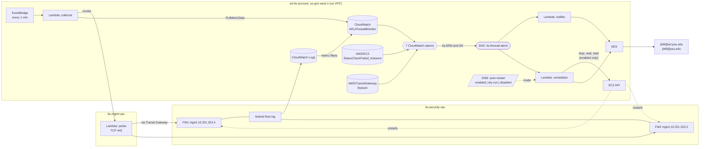

# Firewall Monitoring

Last updated: 2026-11-27

Detects a hung or disconnected Palo Alto VM-Series firewall in the ARL-ITS account (890884507059, us-gov-west-1) and emails an alert through SES. Built after the 2026-11-26 incident, where FW2 was dead for about 28 hours and FW1 hung with no peer, and nothing alerted. See `docs/architecture/networking/troubleshooting-palo-alto-vm-series-ha.md`.

**Recipients:** `jbt8@arl.psu.edu` and `jbt8@psu.edu`, sent from `aws@arl.psu.edu`.

**Status:** Deployed 2026-11-27 as stack `arl-monitoring-firewall` (naming convention: `arl-monitoring-<topic>`). Probe reaches both firewalls, python3.12 runs in GovCloud, and SES delivered alert emails from the sandbox. Forced-alarm test sent to both recipients. A real firewall failure has not yet exercised the alarms.

## What it checks

EC2 status checks do not prove PAN-OS is healthy. FW2 showed "ok" in EC2 while its management plane was dead. So there are four independent signals.

| Alarm | Signal | Fires when |
| --- | --- | --- |
| `its-fw1-instance-status-failed`, `its-fw2-instance-status-failed` | EC2 `StatusCheckFailed_Instance` | Failing for 5 consecutive minutes |
| `its-fw1-management-unreachable`, `its-fw2-management-unreachable` | Probe Lambda TCP 443 connect to the management IP, from the its-mgmt-vpc, every minute | Failed or missing for 5 consecutive minutes |
| `its-fw1-panorama-contact-lost`, `its-fw2-panorama-contact-lost` | Flow log records from the firewall management IP to Panorama (10.254.254.50) | None for 30 minutes (healthy firewalls talk to Panorama about every 15 minutes) |
| `its-security-tgw-traffic-dropped` | TGW `BytesIn` for the Security VPC attachment | Below 10 MiB per 5 minutes for 15 minutes (normal is several GB per hour) |

Missing data counts as a failure for every alarm except the EC2 status checks. A dead monitor therefore alarms instead of staying silent.

Alarms send on both ALARM and OK. CloudWatch only notifies on state changes, so there is no repeat spam during a long outage.

## Auto-remediation

A fourth Lambda (`its-firewall-monitor-remediator`) listens on the same SNS topic and can stop and start a hung firewall. It was deployed 2026-11-27 in `dry-run` mode: it emails what it would have done and changes nothing. A dry-run email has not yet been seen.

| Alarm | Action |
| --- | --- |
| `its-fw1/2-instance-status-failed` | Stop and start that firewall, active or standby |
| `its-fw1/2-management-unreachable` | Stop and start only if it is the standby (2 ENIs). If it is the active firewall (3 or more ENIs), email only and let a person decide |
| Panorama contact lost, TGW traffic dropped | No action, alert only |

Guards, all checked on every run:

- **Mode switch.** SSM parameter `/arl-monitoring/firewall/auto-restart` is `enabled`, `dry-run`, or `disabled`. Anything else is treated as disabled.
- **One at a time.** Skips if the other firewall is pending, stopping, stopped, or shutting down.
- **Loop protection.** Skips if the instance launched less than 60 minutes ago. A stop and start resets the launch time, so no database is needed.
- **No retries.** Lambda retries are off, so a failure cannot trigger a second restart.
- **Scoped IAM.** Stop and start are allowed only on the two firewall instance ARNs.

Every action, dry run, and failure sends an email. A failed restart emails the command to start the instance by hand.

Change the mode. Run this in **PowerShell**. Git Bash rewrites the leading `/` in the parameter name and the command fails with `ParameterNotFound` (in Git Bash, prefix it with `MSYS_NO_PATHCONV=1`):

```
aws ssm put-parameter --profile arl-its-govcloud --region us-gov-west-1 --name /arl-monitoring/firewall/auto-restart --type String --overwrite --value enabled
```

Use `dry-run` or `disabled` as the value to turn it back down. The template sets the parameter to `dry-run` only when it is created or when the template value changes, so a normal redeploy does not reset a mode set by hand.

Limits:

- It does not fix the cause. Someone with firewall access still needs to find out why it hung.
- It can hide that HA failover is unproven. A restarted active firewall may come back before the standby ever takes over.
- A restart takes the firewall's traffic down for several minutes if it is the active one. That is still better than a 15 hour outage.
- The stop waits up to about 12 minutes. If it times out, the instance is left stopping or stopped and the failure email says how to start it.
- Not exercised against real EC2 yet. Unit tests use mocks.

Rollout: it is in `dry-run` now. Force an alarm to confirm the dry-run email (`aws cloudwatch set-alarm-state` on `its-fw2-instance-status-failed`), then set `enabled`. Note a forced alarm in `enabled` mode will really restart the firewall if the guards pass.

## Architecture

### Components

| Component | Name | Runs in | Purpose |
| --- | --- | --- | --- |
| EventBridge rule | `its-firewall-monitor-collector-schedule` | n/a | Triggers the collector every minute |
| Lambda (VPC) | `its-firewall-monitor-probe` | its-mgmt-vpc, prod subnets | Opens a TCP 443 connection to each firewall management IP and returns the results |
| Lambda | `its-firewall-monitor-collector` | AWS service network (no VPC) | Invokes the probe and publishes `ManagementReachable` to the `ARL/FirewallMonitor` namespace |
| VPC flow log | `/its/firewall-monitoring/mgmt-subnet-flowlogs` | Security VPC management subnet | Records traffic between each firewall and Panorama. Two metric filters turn it into metrics |
| CloudWatch alarms | `its-fw*-*`, `its-security-tgw-traffic-dropped` | n/a | Seven alarms. All send to the SNS topic on ALARM and OK |
| SNS topic | `its-firewall-alerts` | n/a | Fan-out point for alarm notifications |
| Lambda | `its-firewall-monitor-notifier` | no VPC | Formats each alarm and emails it through SES |
| Lambda | `its-firewall-monitor-remediator` | no VPC | Stops and starts a hung firewall when the guards allow it, then emails the result |
| SSM parameter | `/arl-monitoring/firewall/auto-restart` | n/a | Mode switch for the remediator: `enabled`, `dry-run`, or `disabled` |

### Data flow

```
Detection
  EventBridge (1 min) -> collector -> probe (its-mgmt-vpc) -> TCP 443 to FW1 10.251.253.4 and FW2 10.251.253.5
                         collector -> CloudWatch metric ARL/FirewallMonitor ManagementReachable (Firewall=fw1|fw2)
  Security VPC mgmt subnet flow log -> CloudWatch Logs -> metric filters -> Fw1/Fw2PanoramaFlowRecords
  EC2 and Transit Gateway publish StatusCheckFailed_Instance and BytesIn on their own

Alerting
  CloudWatch alarms (7) -> SNS its-firewall-alerts -+-> notifier Lambda -> SES -> email (every alarm)
                                                    +-> remediator Lambda -> EC2 stop/start -> SES -> email
                                                    +-> optional backup email (raw alarm, no SES or Lambda)
```

### Diagram



### Design decisions

- **Four independent signals.** No single signal is trusted. EC2 status checks only prove the VM answers on its primary ENI, so they missed a dead PAN-OS management plane. The probe covers that. Flow logs and TGW traffic cover loss of Panorama contact and a silent data plane.
- **The probe runs in the its-mgmt-vpc.** That VPC has a route to the firewall management subnet through the Transit Gateway. The path does not cross the firewall data plane, so the probe still works when a firewall is hung.
- **The probe returns results and does not publish them.** It has no route to AWS APIs. The collector, outside any VPC, does the publishing. This avoids NAT gateways and VPC endpoints for a once-a-minute check.
- **Missing data means failure.** Every alarm except the EC2 status check treats missing data as breaching. If the probe, collector, or flow log stops, the alarm fires instead of going quiet. The EC2 status alarm treats missing data as healthy because a stopped instance publishes nothing and that is expected.
- **The alert path avoids the firewall.** The notifier is outside any VPC and reaches SES over the AWS service network. An outage of the Security VPC cannot block the alert about it.
- **Notifier and remediator are separate functions.** The notifier can only send email. Only the remediator can stop and start instances, and only the two firewall instances. A bug or timeout in the restart logic (up to about 12 minutes) cannot block alerts. The notifier does not read the mode switch, so alarm emails continue when auto-restart is `disabled`.
- **Alarm text lives on the alarm.** Each alarm description carries "what it means and what to do". The notifier only formats it, so operators can read the same guidance in the CloudWatch console.
- **The remediator holds no state.** A stop and start resets the instance `LaunchTime`, which is the loop guard. No database is needed.
- **Logging.** All Lambdas write the standard ARL log format. Every stop and start is logged at INFO with the instance ID and state change. Log groups keep 14 days.

### Security and access

- Each Lambda has its own IAM role (`its-firewall-monitor-*-role`). The names deliberately avoid the `ARL-` prefix so an SSO admin can manage them (see the SCP caveat under Known limits).
- Remediator permissions: `ec2:StopInstances` and `ec2:StartInstances` on the two firewall instance ARNs only, `ec2:DescribeInstances` (read-only, no resource-level scoping exists), `ssm:GetParameter` on the one mode parameter, and `ses:SendEmail` restricted to the sender address.
- Probe security group allows egress only to TCP 443 in the firewall management CIDR. There is no inbound rule.
- `cloudwatch:PutMetricData` for the collector is restricted to the `ARL/FirewallMonitor` namespace.
- No secrets are stored. Everything uses IAM roles.

### Failure modes

| Failure | Result |
| --- | --- |
| Probe, collector, or flow log stops | Management and Panorama alarms fire (missing data is breaching) |
| Firewall hangs | Instance status and management alarms fire. The remediator restarts it if enabled and guards pass |
| Both firewalls down | Remediator restarts neither if the peer is stopped or stopping. A person decides |
| Restart fails or times out | Failure email with the manual start command. Lambda retries are off |
| SES rejects the message (unverified recipient while in sandbox) | Notifier raises so SNS retries. Remediator logs the error. Use the optional backup email for a path independent of SES |
| Remediator misbehaves | Set the SSM parameter to `disabled`. No redeploy needed |

## Files

| Path | Purpose |
| --- | --- |
| `monitoring/firewall-monitoring.yaml` | CloudFormation stack |
| `monitoring/lambda/probe/handler.py` | TCP probe |
| `monitoring/lambda/collector/handler.py` | Scheduled collector and metric publisher |
| `monitoring/lambda/notifier/handler.py` | SNS to SES emailer |
| `monitoring/lambda/remediator/handler.py` | Auto stop/start of a hung firewall (mode set in SSM) |
| `monitoring/tests/` | Unit tests |

## Deploy

Run from the repo root in **Git Bash** or **PowerShell**. Sign in first:

```
aws sso login --profile arl-its-govcloud
```

Run the unit tests:

```
python -m unittest discover -s monitoring/tests
```

Package the Lambda code and upload it to S3. This writes `monitoring/packaged.yaml`, which is generated and should not be committed:

```
aws cloudformation package --profile arl-its-govcloud --region us-gov-west-1 --template-file monitoring/firewall-monitoring.yaml --s3-bucket arl-cf-templates --s3-prefix firewall-monitoring --output-template-file monitoring/packaged.yaml
```

Deploy. `CAPABILITY_NAMED_IAM` is needed because the stack creates named IAM roles:

```
aws cloudformation deploy --profile arl-its-govcloud --region us-gov-west-1 --stack-name arl-monitoring-firewall --template-file monitoring/packaged.yaml --capabilities CAPABILITY_NAMED_IAM
```

To add a backup email that receives the raw alarm without SES or Lambda, add `--parameter-overrides BackupAlertEmail=<address>`. The recipient must confirm the SNS subscription email.

## Test after deploying

1. **Probe reaches both firewalls.** Look at the probe logs. Both lines should say `Reachable=True`:
   ```
   aws logs tail /aws/lambda/its-firewall-monitor-probe --profile arl-its-govcloud --region us-gov-west-1 --since 5m
   ```
2. **Metrics are populating** (wait about 5 minutes). `ManagementReachable` for fw1 and fw2 should be 1. The Panorama flow metrics fill in once the firewalls next contact Panorama (up to 15 minutes).
3. **Force an alarm and confirm the email arrives.** This is the real SES test:
   ```
   aws cloudwatch set-alarm-state --profile arl-its-govcloud --region us-gov-west-1 --alarm-name its-fw2-management-unreachable --state-value ALARM --state-reason "Manual test of firewall alerting"
   ```
   An email with subject `[ALARM] its-fw2-management-unreachable` should reach jbt8@arl.psu.edu. CloudWatch resets the alarm on its next evaluation, which sends an `[OK]` email.
4. **If no email arrives,** check the notifier log:
   ```
   aws logs tail /aws/lambda/its-firewall-monitor-notifier --profile arl-its-govcloud --region us-gov-west-1 --since 15m
   ```

## Known limits and caveats

- **SES sandbox.** arl-its is in the SES sandbox, so every recipient must be a verified identity. The domain identity is `FAILED`. Verified identities are `aws@arl.psu.edu` (sender), `jbt8@arl.psu.edu`, and `jbt8@psu.edu`. See `docs/Centralized-SES-Email-Sending.md`.
- **Adding a recipient.** Verify the address in SES first, or SES rejects the whole message and nobody gets the alert. Run `aws sesv2 create-email-identity --profile arl-its-govcloud --region us-gov-west-1 --email-identity <address>`, have the owner click the link in the verification email (it expires in 24 hours), then redeploy with the full list: `--parameter-overrides AlertToAddresses=jbt8@arl.psu.edu,jbt8@psu.edu,<address>`.
- **Redeploys keep old parameter values.** `aws cloudformation deploy` does not pick up changed template defaults for parameters already set on the stack. Pass `--parameter-overrides AlertToAddresses=...` explicitly whenever the recipient list changes.
- **No SCP change needed now.** The SES SCP (`ARL-Deny-SES-Send-Except-Approved`) is attached only to ARL-ITS-Sandbox. If it is later attached to arl-its or the root, the notifier role will be blocked. Its name (`its-firewall-monitor-notifier-role`) is deliberately not `ARL-SES-Sender-*`, because `ProtectRoles` in `ARL-Guardrails-Global` stops an SSO admin from attaching policies to `ARL-*` roles. At that point, either deploy the role from a StackSet using an approved name or add an exemption.
- **Planned restarts trip the alarms.** Restarting a firewall will fire the management and Panorama alarms for that firewall, then send OK emails.
- **Idle overnight traffic.** If the Security VPC is truly idle, `its-security-tgw-traffic-dropped` can fire falsely. The healthy baseline observed was several GB per hour. Tune `MinimumTgwBytesIn` if needed.
- **Lambda runtime.** The template defaults to `python3.12`, which works in GovCloud Lambda. The account's older functions use 3.8 and 3.9.
- **Unit tests use mocks.** Tests do not touch AWS. Install boto3 locally to run them (`pip install boto3`).
- **Retention.** The stack's log groups keep 14 days. The older `/aws/vpc/flowlogs-paloalto-troubleshooting` group still has no retention and is not managed here.
