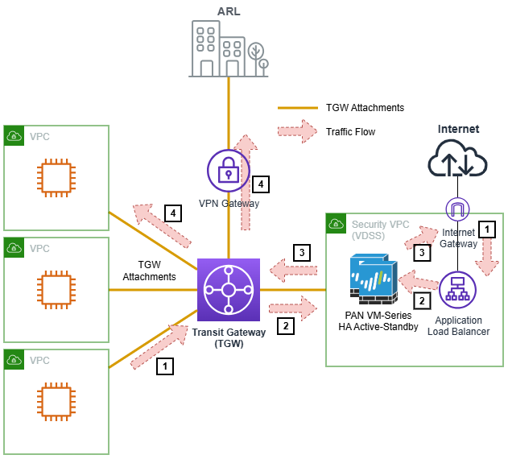
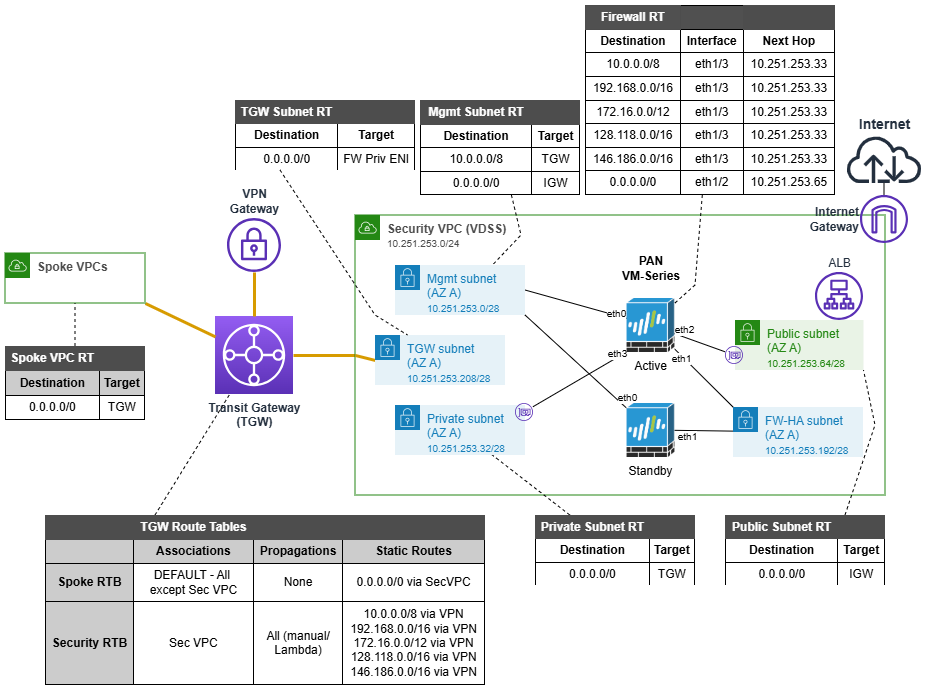
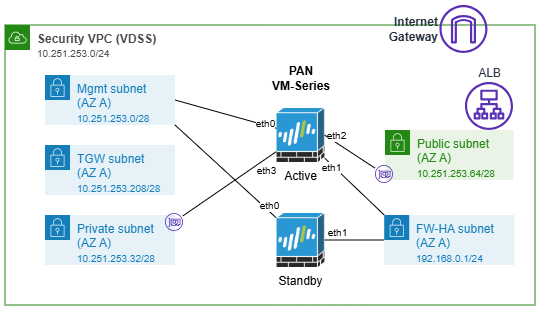
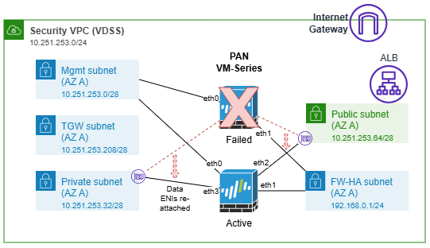
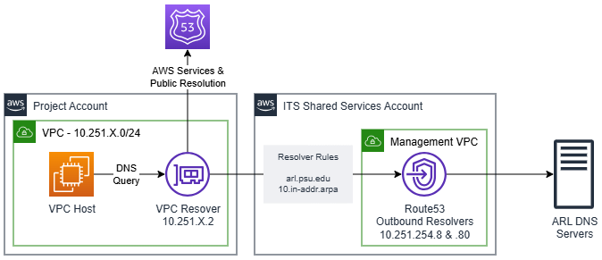
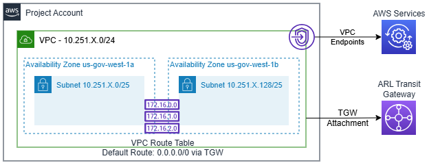

# AWS Networking Design

## Overview

The ARL unclassified enterprise network (NetU) has been extended into AWS GovCloud to provide private networking capabilities for AWS projects. This allows workloads in AWS to consume services available on the internal ARL network, as well as allowing management access to AWS workloads using existing ARL tools. Phase 1 of this network extension is documented at AWS Networking Design - Phase 1 [DEPRECATED]. Phase 2 introduced virtual Palo Alto Networks (PAN) firewalls at the ARL/AWS border to provide layer 7 network traffic inspection.

[AWS Networking Overview](<references/AWS Networking Basics.pptx>)

## Definitions & Acronyms
- **VPC:** Virtual Private Cloud, the primary AWS construct providing logically isolated networking
- **Transit Gateway (TGW):** an AWS service providing connectivity between VPCs, and from VPCs to on-premises networks
- **CAP:** Cloud Access Point; a generic concept representing the network boundary between on-premises and cloud networks, and the services providing connectivity to approved cloud networks and protecting ARL's network from cloud-originated threats
- **SCCA:** the DISA Secure Cloud Computing Architecture
- **Security VPC:** equivalent to the Virtual Data Center Security Stack (VDSS) from the DISA SCCA; hosts network security infrastructure such as edge firewalls and network traffic inspection
- **Management VPC:** equivalent to the Virtual Data Center Managed Services (VDMS) from the DISA SCCA; hosts common managed services such as authentication, configuration, and patching
- **Governance Account:** dedicated account for hosting the Kion application

## Conceptual Design

An AWS Transit Gateway serves as the hub for all connectivity within and between AWS accounts. A site-to-site IPSEC VPN attachment provides connectivity to the ARL Unclassified network. All traffic between AWS VPCs, between ARL NetU and AWS VPCs, and between AWS VPC resources and the Internet is directed through the PAN firewall instances. Outbound access to the Internet flows through the PAN firewalls and out via an Internet Gateway in the Security VPC. Direct inbound traffic from the Internet enters via the Internet Gateway and through the PAN firewalls via an Application Load Balancer.

## IP Allocation

The 10.251.0.0/16 block has been allocated for use in the AWS GovCloud West region.

Additional CIDR blocks can be added to a VPC if necessary, but the primary block of a VPC cannot be modified once created. The high-level allocation of IP ranges is listed below. For the detailed listing of current IP/subnet allocations, see AWS IP Allocations.

| VPC | IP Range | Notes |
|---|---|---|
| **Shared VPC** | 10.251.0.0/18 | Shared VPC in the ITS Shared Services account - hosts shared subnets for project accounts not requiring VPC-level isolation (i.e. a REN)
| **Project VPCs** | 10.251.64.0/18 | Each project account requiring its own VPC gets a /24 from 10.251.64.0 through 10.251.127.0. This allocation can be summarized to 10.251.64.0/18.
| **Project VPCs (future)** | 10.251.128.0/18 | Reserved for future project VPCs if needed (/24s from 10.251.128.0 through 10.251.191.0)
| **ITS VPCs** | 10.251.192.0/18 | Reserved for ITS VPCs
  **--ITS Security VPC** | 10.251.253.0/24 | Security VPC in the ITS Shared Services account - hosts network security infrastructure
  **--ITS Management VPC** | 10.251.254.0/24 | Management VPC in the ITS Shared Services account - hosts management infrastructure
  **--ITS Kion VPC** | 10.251.255.0/24 | Kion VPC in the ITS Governance account - hosts the Kion application

## Logical Design

A site-to-site IPSEC VPN tunnel is established from the ARL S2S VPN firewalls to a Transit Gateway VPN Attachment in the AWS GovCloud US-West region. Static routes are used since ARL has not previously implemented BGP anywhere. A tunnel monitor on the Palo Alto S2S firewall is used to perform failover should a failure occur on either end of the tunnel.

### Sample Packet Walk - Outbound from Spoke

1. Packet destined for a public or ARL IP leaves a spoke VPC via its Transit Gateway (TGW) attachment.
2. The spoke TGW route table default route directs the packet to the Security VPC attachment.
3. The packet enters the active firewall via its private interface and, if permitted, leaves via the Internet Gateway (public destination) or re-enters the TGW (ARL destination).
4. If destined for an ARL IP, the TGW route table associated with the Security VPC directs the packet to the appropriate spoke VPC or VPN attachment.

### Sample Packet Walk - Inbound from Internet

1. Packed destined for an Internet-exposed service reaches the Application Load Balancer (ALB) via the IGW.
2. The ALB uses host header rules to direct the packet to a unique TCP port on the public interface of the active firewall. The firewall applies a Destination NAT translation to the appropriate private service IP/port, based on the port on which it was received from the ALB.
3. If permitted, the packet leaves the private interface of the active firewall and enters the Transit Gateway.
4. The TGW route table associated with the Security VPC directs the packet to the appropriate spoke VPC or VPN attachment.

## Routing and Firewall Detail

Two Palo Alto VM-300 firewalls are deployed on m4.xlarge instances in a single Availability Zone. Palo Alto's built-in High Availability (HA) is used to keep the two firewalls in sync and handle failover. A single AZ deployment was chosen for simplicity; multi-AZ deployments currently require added complexity such as API-based programmatic failover handling or additional VPN attachments using BGP routing. Future functionality being introduced by AWS with Palo Alto as an initial launch partner will simplify a multi-AZ configuration, at which time ARL will transition to the new architecture.

Two Transit Gateway Route Tables are required to achieve the desired traffic flow. The "Spoke" route table (RTB) is the default association route table for the transit gateway. All Transit Gateway attachments except for the Security VPC attachment are associated with this route table, and new attachments are associated by default. The only route in this table is a default route with a next-hop of the Security VPC. The Security Route Table is associated with the Security VPC. All other TGW attachments are propagated to this route table so that the Security VPC can reach all spokes and the VPC attachment. Currently, AWS does not support enabling a route table as the default propagation table separately from the default association route table, so new TGW attachments must be manually associated with the Security RTB.

### Firewall IP Addresses

| Device/Interface | Subnet | Private IP | Gateway | Public IP |
|---|---|---|---|---|
| FW1/eth0 | its-security-mgmt-a | 10.251.253.4 | 10.251.253.1 | 15.200.146.27 (EIP)
| FW1/eth1 | its-security-fwha-a | 10.251.253.196 | N/A |  |
| FW1/eth2 | its-security-public-a	| 10.251.253.71 | 10.251.253.65	| 15.200.39.166 (EIP)
| FW1/eth3 | its-security-private-a	| 10.251.253.38 | 10.251.253.33	
| FW2/eth0 | its-security-mgmt-a	| 10.251.253.5	| 10.251.253.1	| 52.61.142.133 (EIP)
| FW2/eth1 | its-security-fwha-a | 10.251.253.197 | N/A	

**DNS Resolvers:** 10.251.254.9, 10.251.254.90

For additional Firewall deployment details, see Palo Alto AWS Deployment Details.

## Firewall HA Failover

In a failover event, PAN-OS calls the AWS API to move the data plane ENIs connecting the Private and Public subnets to the standby firewall.

### Normal Operations

### Failover

## DNS

By default, resources in VPCs utilize the local VPC DNS resolver (the second IP in each VPC CIDR, for example 10.251.X.2). This resolver is supplied by the default DHCP options set in each VPC. Using the local resolver is required for some AWS services such as VPC Endpoints and EFS, which can only be resolved from within the VPC where they are created.

To allow VPC resources to resolve ARL internal DNS, Route53 Resolver Rules for arl.psu.edu and 10.in-addr.arpa (reverse DNS for 10.*) are shared with the entire AWS organization and associated with all project VPCs. This directs queries for those zones through the Route53 Outbound Endpoints hosted in the ITS Management VPC, to be forwarded to the ARL internal DNS resolvers.

## Project VPC Designs

### Typical/Default Project VPC Design

A typical, simple design for ARL projects consists of a single VPC in the project account with two subnets split across two Availability Zones (AZs). A single /24 IP allocation is divided evenly into two /25 subnets. The VPC has a Transit Gateway Attachment back to the ARL central TGW to provide private networking. IAM policies are applied to project admin/user roles to deny creation and modification of VPC resources, and no Internet Gateways may be created in project VPCs. Optionally, VPC Endpoints may be created to provide direct, private access to AWS services.

### Alternate VPC Design - Private Subnets with NAT

AWS introduced a Private NAT Gateway feature in June 2021, de-coupling the NAT Gateway's previous dependence on an Internet Gateway. This presents an opportunity to extend the typical project VPC by adding unrouted private subnets, using NAT Gateways to translate outbound traffic via the routed subnets. This design is detailed here: Alternate VPC Design - Private Subnets

## Future Roadmap

As usage and bandwidth requirements increase, the IPSEC VPN will be replaced by an AWS Direct Connect, leveraging the high-speed fiber circuits available through Penn State ENCS.

Since service availability in the GovCloud US-East region has improved since ARL's initial deployments into GovCloud US-West, expansion into that region will also be considered to provide a lower-latency option for projects.

## References
- [Palo Alto Networks AWS Architecture Guide](references/paloalto-aws-architecture-guide.pdf)
- [Palo Alto Networks AWS Transit Gateway Deployment Guide](references/paloalto-aws-transit-gateway-deployment-guide.pdf)
- [Palo Alto Networks VM Series on AWS Specsheet](references/paloalto-vm-series-on-aws-specsheet.pdf)