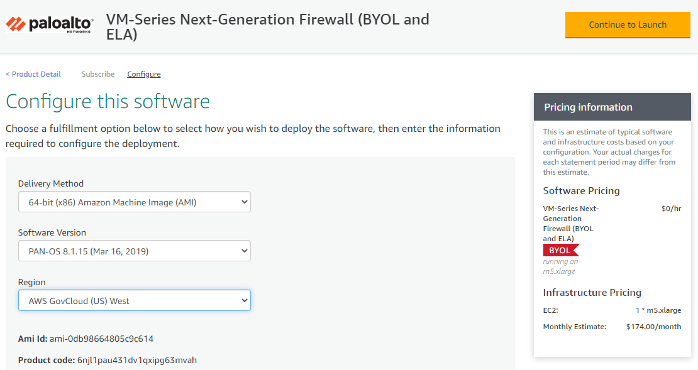
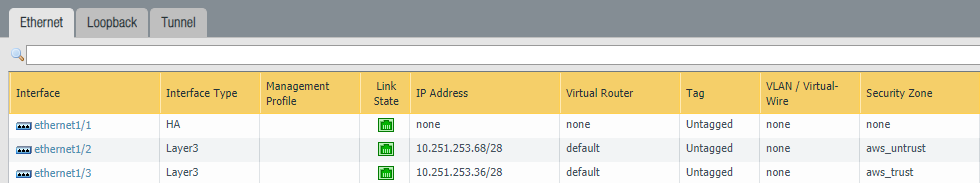
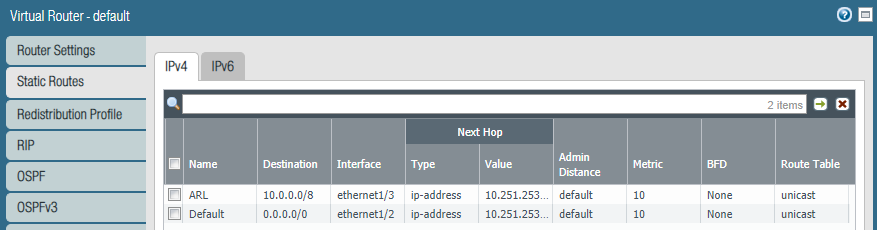
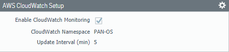
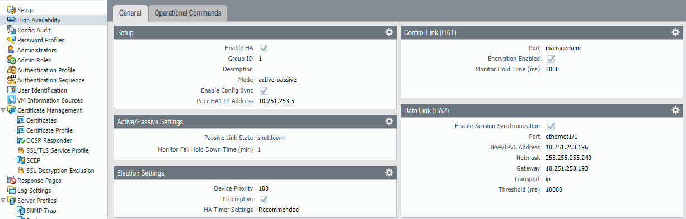
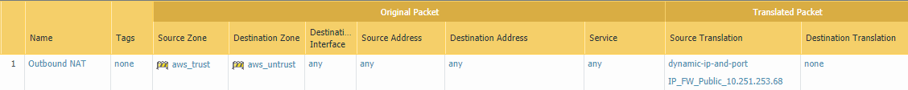
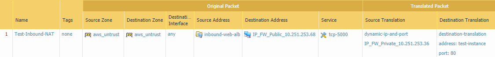
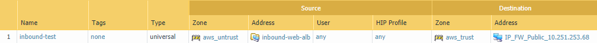

# Palo Alto AWS Deployment Details

## Security Groups

### its-security-fw-mgmt-sg

Firewall management interfaces

| Inbound Rules | Type | Protocol | Port | Source | Description |
| --- | --- | --- | --- | --- | --- |
| | SSH	| TCP | 22 | 10.0.0.0/8 | Firewall SSH management
| | HTTPS | TCP | 443 | 10.0.0.0/8 | Firewall web management
| | Custom TCP | TCP | 3978 | 10.254.254.50/32 | Panorama pushes
| | Custom ICMP - IPv4 | Echo Request | N/A | 10.0.0.0/8 | Ping
| | All Traffic | All | All | its-security-fw-mgmt-sg (self) | Allow firewalls to reach each other for HA
| **Outbound Rules** | **Type** | **Protocol** | **Port** | **Destination** | **Description**
| | All traffic | All | All | 0.0.0.0/0 | 

### its-security-fw-public-sg

Firewall public interfaces

| Inbound Rules | Type | Protocol | Port | Source | Description |
| --- | --- | --- | --- | --- | --- |
| | Custom TCP | TCP | 5000 - 5010 | its-security-web-alb-sg | Inbound traffic for public web applications via ALB. (ALB uses host header rules to direct traffic to unique port per app)
| | ... | ... | ... | ... | Additional rules for future public non-web apps via an NLB
| **Outbound Rules** | **Type** | **Protocol** | **Port** | **Destination** | **Description**
| | All traffic | All | All | 0.0.0.0/0 | 

### its-security-fw-private-sg

Firewall private interfaces

| Inbound Rules | Type | Protocol | Port | Source | Description |
| --- | --- | --- | --- | --- | --- |
| | All traffic | All | All | 10.0.0.0/8 | Allow all ARL private traffic to enter the firewall
| **Outbound Rules** | **Type** | **Protocol** | **Port** | **Destination** | **Description**
| | All traffic | All | All | 0.0.0.0/0 | Allow all traffic to exit the firewall

### its-security-fw-ha-sg

Firewall HA interfaces

| Inbound Rules | Type | Protocol | Port | Source | Description |
| --- | --- | --- | --- | --- | --- |
| | All traffic | All | All | its-security-fw-ha-sg (self) | Allow traffic from other HA interfaces only
| **Outbound Rules** | **Type** | **Protocol** | **Port** | **Destination** | **Description**
| | All traffic | All | All | its-security-fw-ha-sg (self) | Allow traffic to other HA interfaces only

## Launch Instances

PAN-OS 8.1.15 BYOL AMI in GovCloud: ami-0db98664805c9c614

Need to launch from the Marketplace while signed in to both the commercial & GovCloud account: https://aws.amazon.com/marketplace/server/procurement?productId=7064e142-2859-40a4-ab62-8b0996b842e9



### Launch settings

| Setting | Value |
| --- | --- |
| Instance Type | m4.xlarge
| VPC | its-security-vpc
| Subnet | its-security-mgmt-subnet-a
| Auto-assign Public IP | Enable
| Placement group | Add to a new placement group<br>Name: its-pan-spread-placement<br>Strategy: spread<br>(2nd instance, add to existing)
| IAM Role | ITS-PaloAlto-HA-InstanceRole
| Enable termination protection | Enabled
| Network Interface | eth0; set Primary IP to management IP for instance
| Storage | Select its-security-ebs-kms encryption key
| Tags | Name: `<short hostname of instance>`<br>Billing Code: `01540.01`<br>Application: `Firewall`<br>Environment: `prod`
| Security Group | its-security-fw-mgmt-sg

## Basic Setup
Reference: https://docs.paloaltonetworks.com/vm-series/8-1/vm-series-deployment/set-up-the-vm-series-firewall-on-aws/deploy-the-vm-series-firewall-on-aws/launch-the-vm-series-firewall-on-aws.html

Connect via SSH using the keypair generated at instance launch, username admin. Set the admin password:

```
configure
set mgt-config users admin password
commit
exit
exit
```

Stop the instance. Associate an EIP with the management interface and add additional interfaces: HA, public, private. Associate an EIP with the public interface. 

Disable Source/Destination check on the public/private data interfaces.

Start instance, log on via `https://<management IP>` to configure interfaces, routing, hostname, DNS (10.251.254.9, 10.251.254.90), etc.



Configure ethernet1/1 as an HA interface on both instances; only the primary instance gets ethernet1/2 and 1/3 set up.



Enable CloudWatch metrics in Device → Setup → Operations



## HA Setup

Reference: https://docs.paloaltonetworks.com/vm-series/8-1/vm-series-deployment/set-up-the-vm-series-firewall-on-aws/high-availability-for-vm-series-firewall-on-aws/configure-activepassive-ha-on-aws.html

Configure ethernet1/1 as HA2 interface.



## NAT

### Example NAT for Internet-bound traffic:



Source address could be limited to 10.251.0.0/16; translation is to the internal IP of the public interface (ethernet1/2); AWS Internet Gateway does the final translation to public.

### Example NAT & security rule for an inbound service:





ALB receives traffic on 80 and sends it to the FW public subnet IP on port 5000, which translates it again to the final internal destination (test-instance) on port 80.

**Note (2026-11-27):** The public data interface IP was 10.251.253.68 when this example was built. The active firewall's public data ENI is now 10.251.253.71 (`eni-078239a159ad0d2d6`). The old ENI (`eni-009154d3c9ed82852`, 10.251.253.68) still exists, unattached. The `test-inbound` target group still targets 10.251.253.68 and shows `unused`, so this example is not live. Update the target before reusing it.