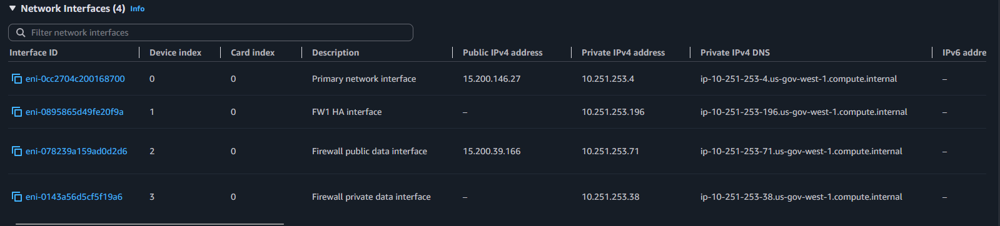
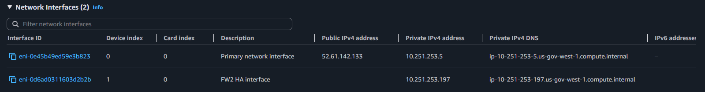
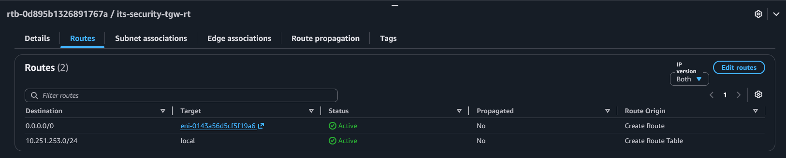

# TROUBLESHOOTING: Palo Alto VM-Series HA

## Overview

This document describes common failure modes observed with the Palo Alto VM-Series HA, particularly during failover and upgrade activities.

## Environment

The firewall pair resides in the ARL-ITS AWS GovCloud account:

| Firewall | Instance ID |
| --- | --- |
| its-aws-usgw1-fw1 | i-0bf7c11474ef2d72e |
| its-aws-usgw1-fw2 | i-0d0b4003b39f93438 |

Only one firewall is active at a time.

## Firewall Interface Architecture

### Active Firewall

The active firewall should have four ENIs attached:

| Interface | Purpose |
| --- | --- |
| Management | Administrative access
| HA | Firewall HA communications
| Private Data Interface (TRUST) | Receives traffic from TGW
| Public Data Interface (UNTRUST) | Internet egress



The standby firewall should have only:

| Interface | Purpose |
| --- | --- |
| Management | Administrative access
| HA | Firewall HA communications



The TRUST and UNTRUST interfaces move to the active firewall during failover.

## Routing Architecture

One of the most confusing aspects of the Security VPC is that the TGW route table does not contain a route to the Internet Gateway. Instead:

```
TGW Route Table
    ↓
TRUST Interface
    ↓
Firewall
```

The firewall itself then performs routing, policy inspection, and NAT before forwarding traffic out the UNTRUST interface.

Only after the traffic exits the UNTRUST interface does the Public Route Table send the traffic to the Internet Gateway.

The route tables themselves do not provide Internet connectivity. They only ensure traffic reaches the correct stage of the inspection path.

### TGW Route Table (its-security-tgw-rt)

The TGW route table sends Transit Gateway traffic to the active firewall and is associated with the TGW attachment subnets. Traffic arriving from project VPCs enters the its-security-vpc through the Transit Gateway and is immediately forwarded to the active firewall's TRUST interface for inspection.



The default route should point to the ENI associated with the active TRUST interface. Unlike a traditional route table, the purpose of this route is not to provide Internet access, but rather to force all Transit Gateway traffic through the active firewall before any routing or NAT decisions are made.

If this route points to the wrong ENI, traffic may be forwarded to an inactive firewall interface rather than the active firewall. During an October 2026 outage, a stale route continued pointing to a previously active TRUST-side ENI after failover. As a result, traffic entering the Security VPC was forwarded to an interface that was no longer processing traffic, causing widespread connectivity failures until the route was updated to reference the active TRUST interface.

### Public Route Table (its-security-public-rt)

The Public route table is associated with the firewall's public-facing subnet and provides Internet access for the active firewall's UNTRUST interface.

Unlike the TGW route table, this route table is responsible for moving traffic from the firewall's public interface to the Internet.

If this route is missing or incorrect, Internet connectivity will fail even if traffic successfully reaches and traverses the firewall.

### Traffic Flow

```
Workload VPC
    ↓
Transit Gateway
    ↓
its-security-tgw-rt
    ↓
Trust Interface
(Private Data ENI)
    ↓
Palo Alto Firewall
    ↓
Untrust Interface
(Public Data ENI)
    ↓
its-security-public-rt
    ↓
Internet Gateway
    ↓
Internet
```

## Troubleshooting

### STEP 1: Verify the active firewall

Determine which firewall is active.

Verify:

- The active firewall has all four ENIs attached: Management, HA, TRUST, UNTRUST
- The standby firewall should only have two ENIs attached: Management, HA
- If the data-plane interfaces are not attached to the expected firewall, stop troubleshooting routing and investigate HA status first.
- The active firewall passes both EC2 status checks (system and instance). Check with:

```
aws ec2 describe-instance-status --profile arl-its-govcloud --region us-gov-west-1 --instance-ids i-0bf7c11474ef2d72e i-0d0b4003b39f93438 --include-all-instances
```

An `impaired` instance status on the active firewall means PAN-OS has hung. HA will not necessarily fail over (see the 2026-11-26 incident below). Restart the active firewall from EC2. See "Recovery" below.

To see whether traffic is passing through the Security VPC, check the Transit Gateway `BytesIn` metric (AWS/TransitGateway) for the Security VPC attachment `tgw-attach-0a18e5d1ef249dfae`. `BytesIn` is traffic coming back from the firewall. Zero while `BytesOut` stays high means the firewall is dropping everything.

### STEP 2: Verify the TGW Route Table

In AWS, navigate to VPC → Route Tables → its-security-tgw-rt

Verify:

- The default route (0.0.0.0/0) points to the active TRUST interface ENI.

This route determines which firewall receives all Transit Gateway traffic.

If the route points to a stale or inactive ENI, project VPC traffic will never reach the active firewall.

### STEP 3: Verify the Public Route Table
In AWS, navigate to VPC → Route Tables → its-security-public-rt

Verify:

- The default route (0.0.0.0/0) points to the Internet Gateway.

Even if traffic successfully reaches and traverses the firewall, it cannot reach the Internet unless the Public Route Table forwards traffic to the Internet Gateway.

### STEP 4: Verify the UNTRUST Interface

Identify the active UNTRUST (i.e., public data) interface.

Verify:

- The interface is attached to the active firewall.
- The network interface status is In-use.
- The source/destination check is False.
- The interface has a public IP address.
- The UNTRUST interface is responsible for Internet egress.

If the interface loses its public IP address, traffic can reach the firewall and be allowed, but Internet connectivity may still fail.

### STEP 5: Test DNS Resolution

From a workload instance:

```
dig aws.amazon.com
```

Successful output should show

```
status: NOERROR
```

and one or more IP addresses.

**Note:** Successful DNS resolution does not confirm Internet connectivity. It's just finally "not DNS."

### STEP 6: Test Actual Internet Connectivity

Be careful of PrivateLink.

For example:

```
curl -I https://sts.us-gov-west-1.amazonaws.com
```

can return a false positive. STS uses a VPC Endpoint. You can confirm with:

```
dig sts.us-gov-west-1.amazonaws.com
```

So this traffic never traverses the Internet-facing firewall path.

Instead, use endpoints that require actual Internet access:

```
curl -I https://aws.amazon.com
```

```
curl -I https://signin.amazonaws-us-gov.com
```

You should receive HTTP/2 200 or another valid HTTP response.

### STEP 7: Run Traceroute

From an affected workload:

```
traceroute signin.amazonaws-us-gov.com
```

During an outage, the first meaningful hop might be:

```
traceroute to signin.amazonaws-us-gov.com (52.46.232.127), 30 hops max, 60 byte packets
 1  * * *
 2  ip-10-251-253-38.us-gov-west-1.compute.internal (10.251.253.38)  1.345 ms  1.662 ms  1.665 ms
 3  * * *
 4  * * *
```

This would indicate traceroute reaches the TRUST interface but fails immediate afterward (e.g., firewall routing, public interface configuration, NAT, Internet egress).

## Recovery

If the active firewall is hung and the standby did not take over:

1. Stop the active firewall. A stop gives the standby a definitive heartbeat loss. A soft reboot of a hung guest may not work.
2. Check whether the standby now holds all four ENIs. The TGW route references the TRUST ENI ID, which moves with the interface, so the route does not need to change.
3. If the standby did not take over within a few minutes, start the stopped firewall. It still holds the data ENIs and its configuration persists, which restores service.
4. Confirm the TGW `BytesIn` metric for the Security VPC attachment is above zero.

Data ENIs stay attached to a stopped instance until the peer moves them.

## Manual Health Checks and Restart Commands

Use these when you have Panorama (read-only is enough) and AWS access, but no direct firewall login. EC2 status checks only prove the VM answers on its primary ENI. They do not prove PAN-OS is working. A firewall can show "ok" in EC2 and still be dead. On 2026-11-27, FW2 was in exactly that state.

### Check 1: Panorama Managed Devices

Panorama is at 10.254.254.50.

1. Open the **PANORAMA** tab, then **Managed Devices > Summary**.
2. Find the DC-AWS group. It lists `its-aws-usgw1-fw1` and `its-aws-usgw1-fw2`.
3. Both firewalls should show **Connected** in the Device State column. The group header shows how many are connected, for example `DC-AWS (1/2 Devices Connected)`.

A firewall showing **Disconnected** while EC2 reports it healthy has a dead PAN-OS management plane or lost its path to Panorama. The HA Status column was blank for these firewalls on 2026-11-27, so Panorama does not show HA state here.

### Check 2: Panorama HA system logs

1. Open the **MONITOR** tab, then **Logs > System**.
2. Enter the filter `(subtype eq ha)` and press Enter. Make sure the closing parenthesis is there.
3. Set the time range in the top-right dropdown (for example, Last 24 Hrs).
4. To see when a firewall dropped off Panorama, filter on `(description contains 'its-aws-usgw1-fw2')` and look for disconnect entries.

On 2026-11-27 the HA filter returned no results for the previous 24 hours, which includes the FW1 hang. Either the firewalls do not forward HA logs to Panorama or nothing was logged. Do not treat an empty result as proof that HA is healthy.

### Check 3: HA state on the firewall (through Panorama)

This has not been tried yet. As of 2026-11-27, Panorama only showed read-only template settings.

1. In the top-left dropdown on any Panorama page (it shows `Panorama` by default), choose `its-aws-usgw1-fw1`. Panorama should open that firewall's own interface. FW2 cannot be reached this way while it is disconnected.
2. Check the **Dashboard > High Availability** widget for the local state and the peer state.
3. Check **Device > High Availability** for the local HA mode, peer IP, preemption, and monitoring settings.

HA settings are not in the `Network-AWS-FW` template. On 2026-11-27, Enable HA was unchecked there and the peer IP, group ID, and priority were blank. The HA configuration appears to be local on each firewall, so the template view cannot confirm it.

### Check 4: Can you reach the management interfaces?

Run in **PowerShell** from a workstation on the ARL network:

```
Test-NetConnection 10.251.253.4 -Port 443
```

```
Test-NetConnection 10.251.253.5 -Port 443
```

10.251.253.4 is FW1 and 10.251.253.5 is FW2. `TcpTestSucceeded : True` means the management web interface is responding. `False` (and a ping timeout) means PAN-OS on that firewall is not responding.

Both management ENIs are in the same subnet with the same security group, so a difference in result points to the firewall and not to AWS networking. Verify that again if the subnet or security groups change.

### Restart a firewall from the command line

Run in **PowerShell** or **Git Bash**. These commands use the GovCloud session, so sign in first:

```
aws sso login --profile arl-its-govcloud
```

**Only restart the firewall that is hung or unreachable.** If only one is unhealthy, never stop both. The firewall carrying traffic is the one holding all four ENIs. Do not stop the healthy active firewall.

Restart FW1 (`i-0bf7c11474ef2d72e`). First stop it:

```
aws ec2 stop-instances --profile arl-its-govcloud --region us-gov-west-1 --instance-ids i-0bf7c11474ef2d72e
```

Wait until it is stopped:

```
aws ec2 wait instance-stopped --profile arl-its-govcloud --region us-gov-west-1 --instance-ids i-0bf7c11474ef2d72e
```

Then start it:

```
aws ec2 start-instances --profile arl-its-govcloud --region us-gov-west-1 --instance-ids i-0bf7c11474ef2d72e
```

Restart FW2 (`i-0d0b4003b39f93438`) the same way, with its instance ID. First stop it:

```
aws ec2 stop-instances --profile arl-its-govcloud --region us-gov-west-1 --instance-ids i-0d0b4003b39f93438
```

Wait until it is stopped:

```
aws ec2 wait instance-stopped --profile arl-its-govcloud --region us-gov-west-1 --instance-ids i-0d0b4003b39f93438
```

Then start it:

```
aws ec2 start-instances --profile arl-its-govcloud --region us-gov-west-1 --instance-ids i-0d0b4003b39f93438
```

A stop and start is used instead of a soft reboot because a hung guest may ignore a reboot. Stopping the active firewall also gives the standby a definitive heartbeat loss, though on 2026-11-26 and 2026-11-27 the standby did not take over.

### Verify after a restart

Check the instance state and how many ENIs each firewall holds. The active firewall should have 4 and the standby 2:

```
aws ec2 describe-instances --profile arl-its-govcloud --region us-gov-west-1 --instance-ids i-0bf7c11474ef2d72e i-0d0b4003b39f93438 --query "Reservations[].Instances[].[Tags[?Key=='Name']|[0].Value,State.Name,length(NetworkInterfaces)]" --output text
```

Check that both firewalls pass EC2 status checks (see Step 1). Then confirm in Panorama that both show **Connected**, and re-run Check 4. Finally, confirm the Transit Gateway `BytesIn` metric for the Security VPC attachment is above zero (see Step 1).

## Incident: 2026-11-26 Active Firewall Hang, No HA Failover

**Impact:** Traffic through the Security VPC dropped from about 4 to 5 GB/hr to about 0 starting around 18:00 to 19:00 ET on 2026-11-26. It was restored at about 09:54 ET on 2026-11-27, roughly 15 hours.

**What happened:**

- FW1 (i-0bf7c11474ef2d72e) became active at 05:32 ET on 2026-11-26 by attaching the TRUST and UNTRUST ENIs to itself.
- FW1's EC2 instance status check began failing between 17:38 and 18:38 ET the same day. The system status stayed OK, so the AWS host was healthy and the guest was hung.
- FW2 (i-0d0b4003b39f93438) stayed standby. It made no EC2 API calls and did not take over, including during a 3 minute window on 2026-11-27 when FW1 was stopped.
- On 2026-11-27, Panorama showed FW2 as **Disconnected** (`DC-AWS (1/2 Devices Connected)`). FW2's management interface did not answer ping or TCP 443 from an ARL workstation, while FW1's answered. EC2 reported FW2 healthy the whole time. Both management ENIs share a subnet, security group, and AMI, so this was a PAN-OS problem on FW2 and not AWS networking. FW2 had no working management plane, which likely explains why it never took over.
- VPC flow logs (`/aws/vpc/flowlogs-paloalto-troubleshooting`) show FW2's management ENI (`eni-0e45b49ed59e3b823`) exchanged traffic with Panorama (10.254.254.50) every 15 minutes, without a gap, until 10:35 UTC (05:35 ET) on 2026-11-26. Nothing followed until FW2 was restarted on 2026-11-27. That is the same minute FW1 attached the data ENIs. The most likely sequence is that FW2 was the active firewall and died at about 05:30 ET, FW1 took over as designed, and FW1 then hung about 12 hours later with no working peer. This is inferred from timing and was not confirmed in PAN-OS logs. If it is right, HA failover worked once, and the real gaps are that nothing alerted when FW2 went Disconnected and FW2 ran dead for about 28 hours.
- AWS routing was correct throughout: the TGW route table default route pointed at the attached TRUST ENI, the public route table pointed at the IGW, and the UNTRUST ENI had its EIP and source/destination check disabled. There were no TGW blackhole or no-route drops.

**Resolution:** FW1 was stopped and started from EC2 on 2026-11-27. It passed status checks at 09:53 ET and traffic resumed at 09:54 ET. FW2 was then stopped and started the same way. It passed status checks at about 10:21 ET, and its management interface answered on TCP 443 at 10:21 ET. FW1 kept all four data ENIs and traffic was unaffected.

**Not determined:** why FW1 hung, why FW2 died at about 05:30 ET on 2026-11-26, and whether FW2 would have taken over had it been healthy. Neither firewall's PAN-OS logs or HA state were reviewed because the AWS-side responders do not have firewall access.

**Open follow-up:**

- Review `show high-availability state` and `show high-availability all` on both firewalls.
- Confirm which ENI IDs the HA configuration references. There is an unattached "Firewall public data interface" ENI (`eni-009154d3c9ed82852`, 10.251.253.68) left over from an earlier build. The active firewall uses `eni-078239a159ad0d2d6` (10.251.253.71).
- Confirm FW2 can reach the EC2 API from its management interface and that it has the same IAM instance profile role (both currently use `ITS-PaloAlto-HA-InstanceRole`).
- Pull FW1's system logs from before the hang.
- Treat HA failover as unproven until tested.
- Add alerting when a firewall shows Disconnected in Panorama or fails EC2 instance status checks (for example, a CloudWatch alarm on `StatusCheckFailed_Instance` for both instances).
- Set a retention period on the `/aws/vpc/flowlogs-paloalto-troubleshooting` log group. It has none and holds about 12.7 GB. Only the Security VPC flow logs exist in CloudWatch. No PAN-OS system or HA logs are shipped there.

**Context:** CloudTrail shows ENI detaches, which indicate failovers, on 2026-11-15, 11-16, 11-18, 11-19, 11-20, and 11-26, along with manual reboots and stop/starts on 11-18, 11-19, and 11-23.

## More Information
https://docs.paloaltonetworks.com/vm-series/deployment/public-cloud/set-up-the-vm-series-firewall-on-aws